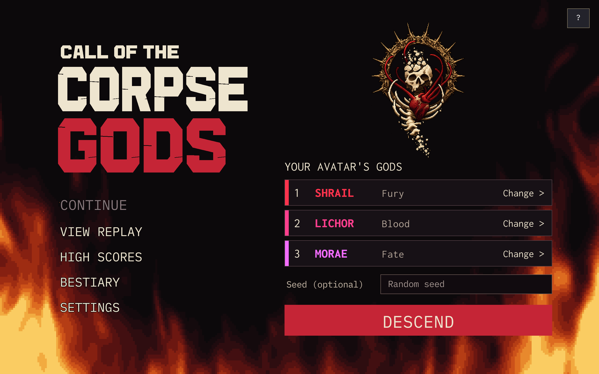
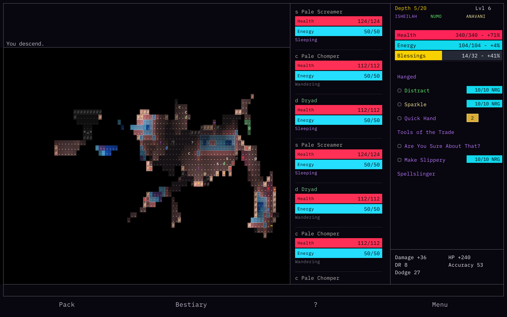
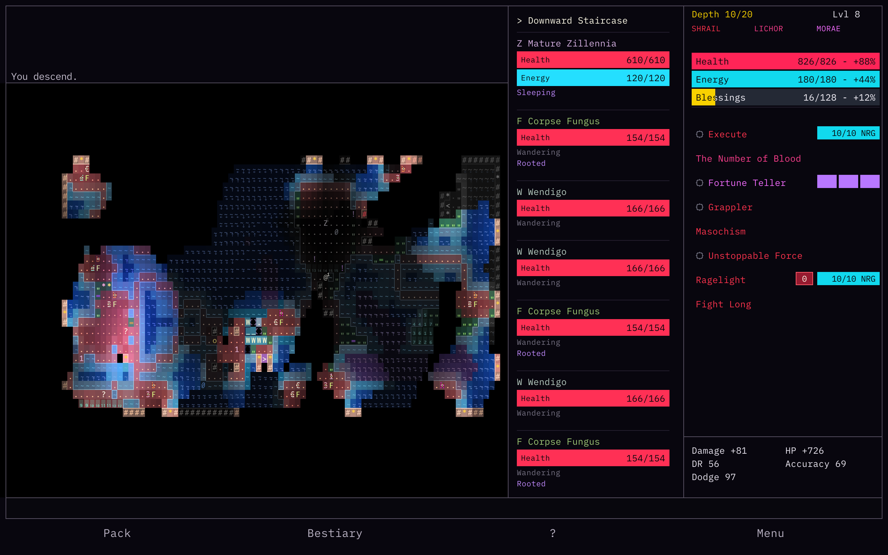
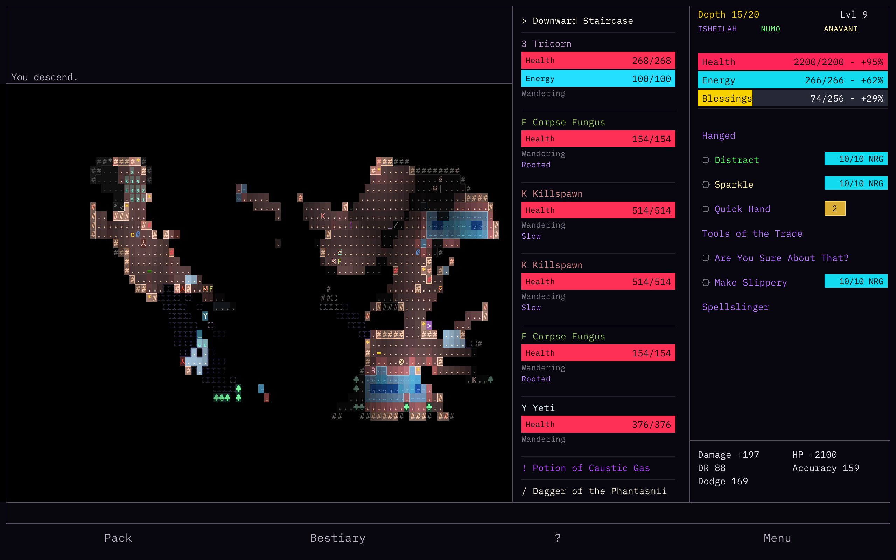
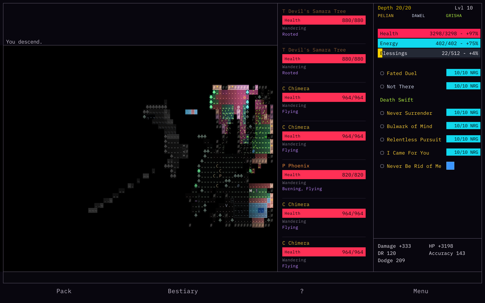

# Call of the Corpse Gods

## Play the Windows build

**[Download Call of the Corpse Gods: R52 Final Turn](https://github.com/ConnorBache/Call-of-the-Corpse-Gods/releases/tag/r52-final-turn-20261126)**

### Screenshots

Click any screenshot for the full 2560 × 1600 image.

[](docs/screenshots/r52-final-turn/main-menu.webp)

| Depth 5 | Depth 10 | Depth 15 |
| :---: | :---: | :---: |
| [](docs/screenshots/r52-final-turn/depth-05.webp) | [](docs/screenshots/r52-final-turn/depth-10.webp) | [](docs/screenshots/r52-final-turn/depth-15.webp) |

<details>
<summary>Depth 20 (final-floor spoiler)</summary>

[](docs/screenshots/r52-final-turn/depth-20.webp)

</details>

## About this source branch

A separate native implementation of the frozen v48 game. The browser release is retained unchanged in the sibling `release-v48` workspace. Gameplay uses Rust; the SDL2 desktop has no browser, WebView or JavaScript runtime. JavaScript under `tools/` is development-only reference testing.

## Source on this branch: R51 follow-up

New runs use simulation revision 51; existing saves retain their recorded revision. This follow-up simplifies the HUD, links monster and left-profile highlighting, preserves terrain beneath the player, uses native drawable resolution automatically, and persists Bestiary discovery across runs. The five stats use Damage and HP display units. See [UI scope and verification](docs/quiet-ui-r51.md) and [the follow-up index](docs/revision51-follow-up-index.md) for gameplay changes, exact compatibility boundaries and test evidence. Existing priced immediate-benefit toggles pay their first turn on activation without a duplicate same-turn charge. [Restored energy costs](docs/revision50-ability-energy.md) are explicit R50-and-newer amendments, not identical historical R50 behavior. Windows cross-compilation is not Windows runtime verification.

## Historical revision 39 notes

Revision 39 makes the Shard of the Borge an ordinary equippable weapon: normal accuracy, permanent death on a successful hit, and hit-only breakage. Throwing works, with missed throws recoverable on the active plane, including Dreamwalking. Designer Borge/kill copy is applied; see [the Shard contract](docs/shard-weapon-r39.md) and [verification](docs/verification-r39.md). Explicit revision 29–38 runs retain their prior mechanics.

Revision 38 fixes required-item stair reservations and revision-aware generation budget preflight, and adds bounded atomic recovery for valid placement failures; see [the generation hardening contract](docs/generation-hardening-r38.md). Monster-driven forests and icy mountains, snowmelt puddles, ordered spatial shortcuts, permanent Hellfire and round Corn dimensions are implemented; see [revision 37 rules and numerical defaults](docs/sub-biomes-r37.md). Non-Euclidean pockets begin at floor 20 without projected vision; see [pocket rules and defaults](docs/non-euclidean-r36.md). The Epidite displays a map countdown only in the final nine turns. Linked same-floor portals remain implemented from depth 10; see [portal rules and defaults](docs/portals-r35.md). Phantasmii/Dreamwalking, Epidite Blessed hearts and Ahvamitt/Mask of Trickery remain implemented. See [revision 34 rules and caveats](docs/release-r34.md). Historical revision 29–38 gameplay remains reproducible. Original art is preserved; the Queen lore and five selected copy entries now use the designer's replacement wording. Native tests and cross-build verification are not a claim of Windows runtime verification.

## Build and run

Rust 1.99.1 is pinned. With Cargo and the SDL2 development library available:

```sh
cargo run --release -p corpse-desktop --locked
cargo test --workspace --locked
```

The workspace-specific `tools/cargo.sh` uses the isolated installed toolchain. The bestiary has 82 pages and 84 embedded RGBA creature-art plates. Original PNG masters live under `crates/corpse-desktop/assets/creatures`; packaged builds embed their distribution versions and need no loose-art folder. Fonts, the ASCII atlas and menu logo are also embedded. Third-party asset notices are preserved.

Windows cross-build instructions are in `docs/windows-cross-build.md`. Cross-compilation does not mean the program has been run on Windows.

## Controls

- Arrows/roguelike keys move; click known ground to follow a previewed route.
- I opens Pack; M opens the illustrated Bestiary. X previews the nearest safely reachable unexplored frontier; press X again to follow it.
- Bestiary discoveries and unread pages persist beside profile.json independently of individual runs.
- Click divine abilities to use them; right-click for their effects.
- While aiming, movement keys move the target cursor and Enter confirms it. Escape cancels. Physical delivery paths, impacts and affected areas are shown separately.
- ? opens the menu; Settings contains resolution and display mode. Alt+Enter cycles display modes. Ordinary-run accepted actions save automatically; F5 retries a save and F9 resumes. DEBUG floor tests never overwrite ordinary autosave/Continue or high scores; see the [DEBUG v2 guide](docs/debug-floor-testing-v33.md). Ordinary death removes the resumable save. Save, appearance, profile.json and replays/ defaults use the per-user configuration directory; --save, --profile and --replay-dir preserve explicit path overrides.
- Choose Unblessed, Blessed or Avatar with the mode button beside DESCEND on the main menu. Click it or focus it with Tab/arrow keys and use Enter, Space, Left or Right. DESCEND keeps that choice and opens the seed form. New descents receive a fresh seed; the start form permits an explicit seed.
- The title emblem’s isolated heart layer beats while blood pulses travel along the separate veins behind stationary ribs. Original pixels are preserved; reduced motion keeps it still. No animation advances gameplay.

## Architecture

- `corpse-core`: typed deterministic state, simulation, generation, persistence and temporal snapshots.
- `corpse-desktop`: detached observations, SDL input/rendering, fixed-layout panels, manual and appearance authoring.
- `corpse-fixtures`: parity/replay command-line utilities.

State uses ordered collections and explicit source-compatible numeric/RNG rules. Shared floor/actor blocks reduce snapshot copying. Rendering and cosmetic animation never advance simulation or consume gameplay RNG.

## Verification and current scope

See `docs/native-engine-admission-gaps.md`, `docs/ability-native-coverage.md`, `docs/foundation-coverage.md`, and the linked `docs/complexity-index.md`. These distinguish executable behavior, tested cases, unsupported import states, presentation differences and measured performance. Every catalog entry or successful compile is not a completeness claim.

This is a playable native preview. The current integrated test results, native-renderer checks, platform limits and clearly separated historical SDL acceptance are recorded in NATIVE-VERIFICATION.md. Do not substitute old benchmark numbers for the current build or describe Windows runtime as verified. Native save envelopes retain fixture/genuine provenance separately from gameplay state. Genuine runs now record high scores and replays; controlled fixtures, developer runs and replay playback do not.

The owner intends an open-source game; a project-wide license has not yet been selected. Existing third-party licenses and notices remain applicable. This workspace does not authorize publication.

## Floor playtesting

Choose **Play from x'th floor** for the revision-38 **DEBUG** setup: select floor
1–40, vessel and gods; reroll or reuse the exact seed. Actual preceding-floor
hearts are reconstructed and **you choose each real earned level-up offer**.
Every ordinary prior ground/carried item is retained in a separate loadout stash;
the normal twenty-slot Pack and starter equipment remain unchanged unless you
choose a loadout. Full health/energy at entry is explicit; combat consumption,
optional quest prizes and event/summon extras are not assumed. DEBUG does not
write autosave/Continue or high scores. See [the workflow, headless commands and
verification notes](docs/debug-floor-testing-v33.md). Legacy v1 replay compatibility
is retained, but new floor starts no longer auto-pick abilities or discard loot.


## Opt-in timing test
Run `tools/run-timing.sh` or `tools/run-timing.ps1` with the pinned toolchain to measure command phases, observations, software rendering and saving. See `docs/timing-profiling.md`. Normal builds have no timing feature; the timing feature itself does not change gameplay rules.

## First dirty-state and scheduling cleanup batch

The bounded runtime work and deferred systems are documented in
[docs/DIRTY-SCHEDULING-FIRST-PASS.md](docs/DIRTY-SCHEDULING-FIRST-PASS.md).
This is not completion of the full scheduling migration or universal complexity
audit. See the document for exact cache invalidation, compatibility and
verification limits; do not substitute the older baseline timings for new
measurements.

## Creature identity lookup and floor slots

The source now preserves stable creature wire IDs while providing a sparse expanding
index and reusable generation-checked floor slots. Canonical actor order/save shape
are unchanged. See `docs/creature-identity-index.md` for public APIs, admission rules,
complexity, memory bounds and measured limitations. `docs/hover-exit-sequencing-review.md`
documents the narrowly reordered possible-exit hover eligibility check.

The optional `creature_lookup_bench` example reports retained index allocation and
lookup costs for synthetic populations; it is not a 100k-enemy gameplay benchmark.


## GitHub source import and large fixture

This checkout preserves the complete verified R51 source. The 116,885,985-byte
Mini-Me fixture is stored as two tracked raw parts below GitHub's per-file limit.
The std-only corpse-core build script automatically reconstructs the ignored JSON
on a normal Cargo build/test, checks exact bytes against the parts, and refuses
to overwrite a changed local file. No Git LFS, Python or extra crate dependency
is needed for automatic restoration. A writable checkout with hard-link support
is required; a read-only checkout cannot hydrate the fixture. Windows behavior
of this import helper has not been freshly tested.

Run `python3 tools/verify-github-import.py` to check preserved source hashes.
Run `python3 tools/test-github-fixture-restoration.py` with Rust/Cargo 1.99.1
available to exercise helper unit tests and plain-Cargo clean/deleted-fixture
restoration. These are packaging checks, not the complete game test suite.
Run `tools/cargo.sh test --workspace` for the project suite.

The original source provenance and all original file hashes are retained in
`docs/git-import-provenance.json`. Historical results remain historical. The
pre-reset local import history was lost; this import uses new honest commits
and retains the real signed original GitHub root.
