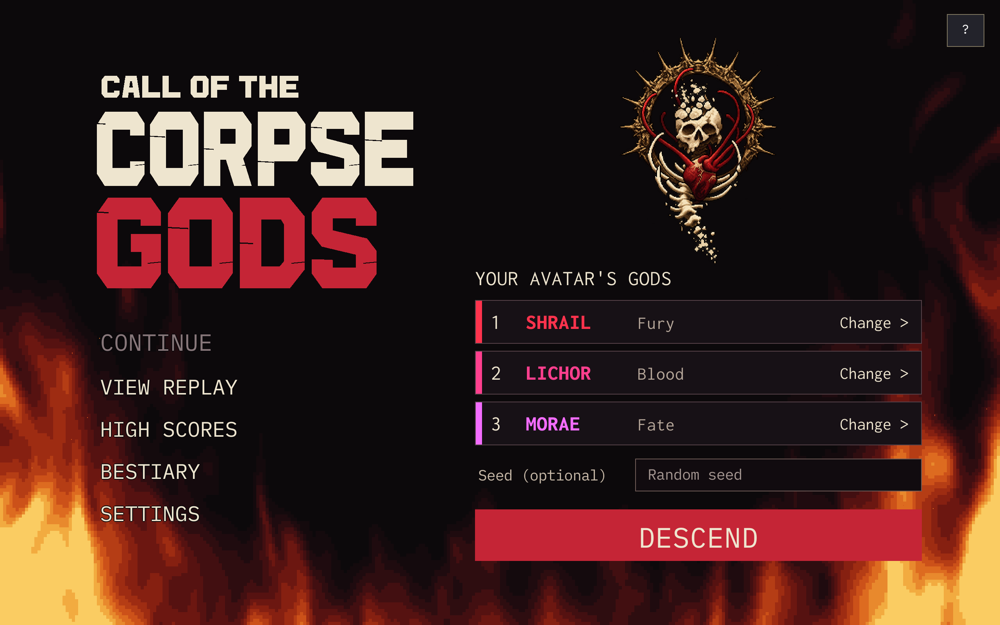
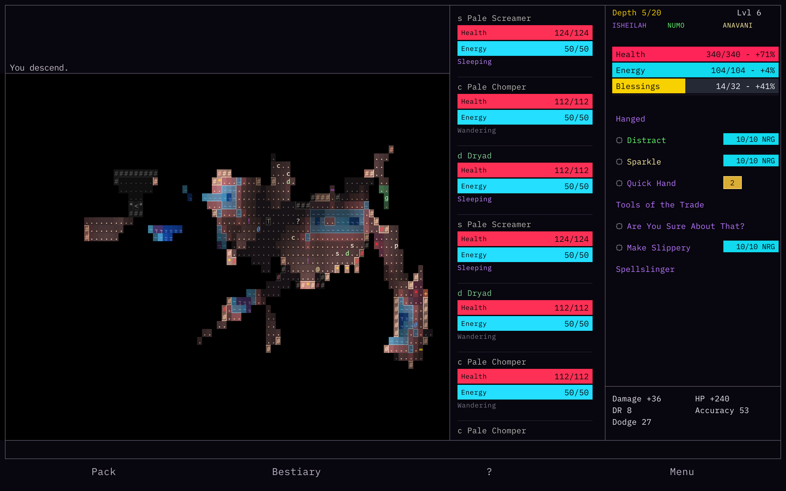
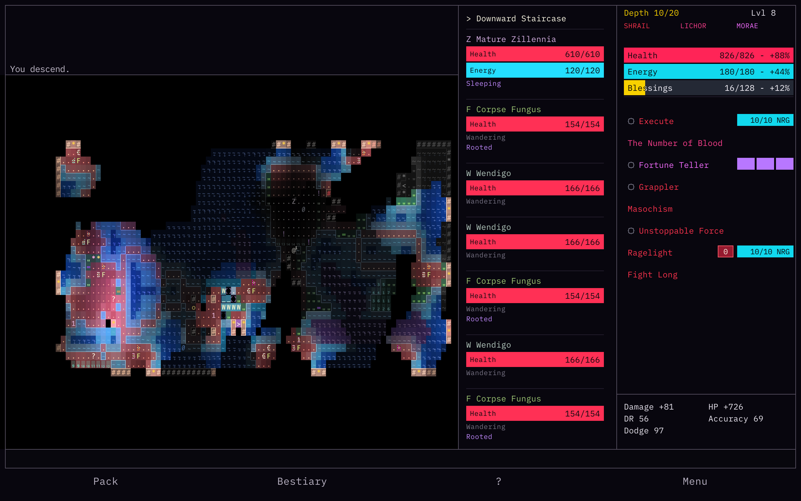
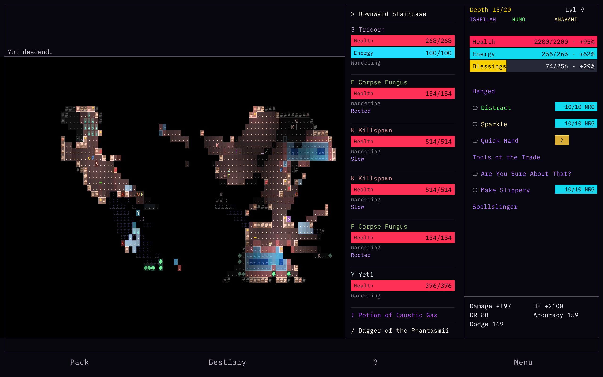
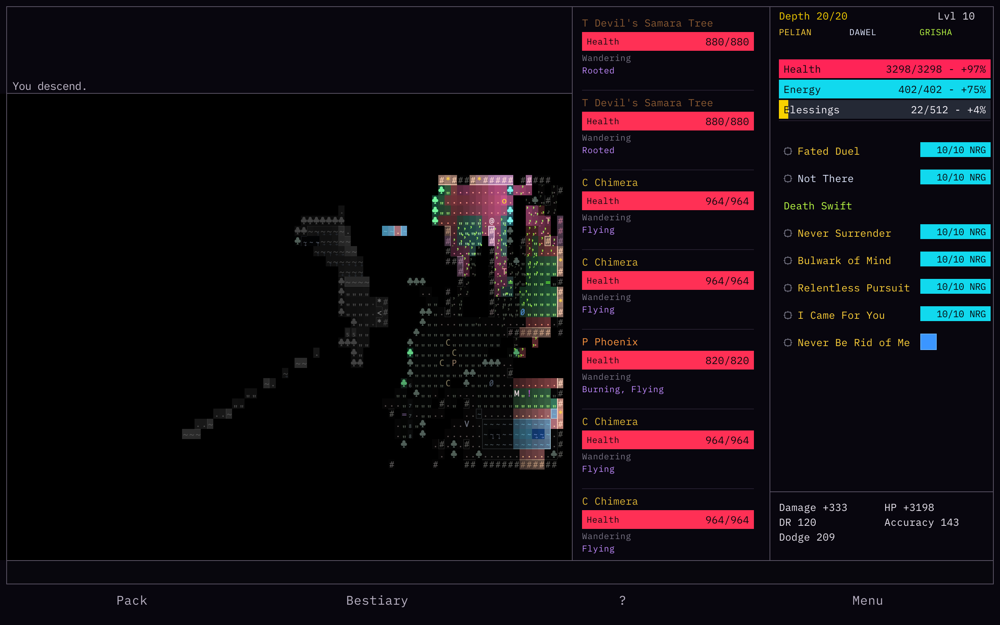

# Call of the Corpse Gods screenshots

Five 2560 × 1600 captures from [R52 Final Turn](https://github.com/ConnorBache/Call-of-the-Corpse-Gods/releases/tag/r52-final-turn-20261126). The dungeon shots are staged on real generated floors and rendered with the game's normal lighting, fog of war, and interface. Click an image to open it at full resolution.

## Main menu

## Depth 5

## Depth 10

## Depth 15

Depth 20 (final-floor spoiler)

